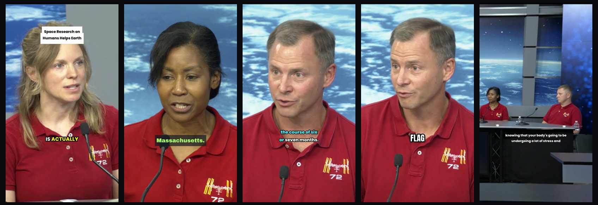
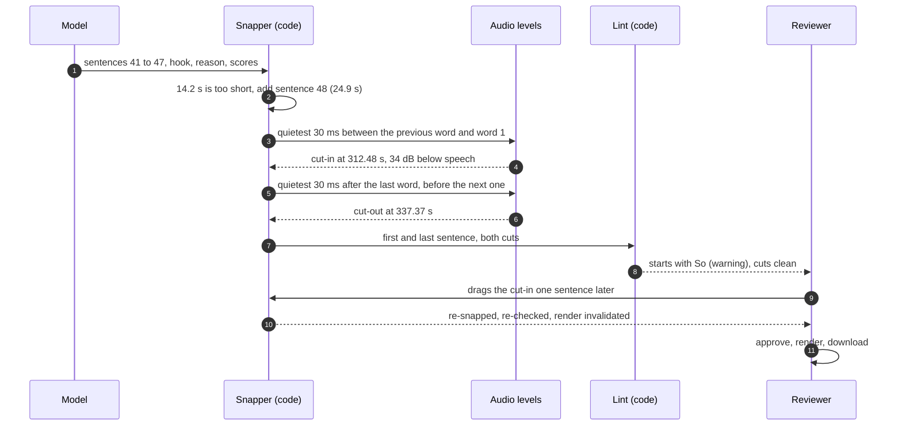
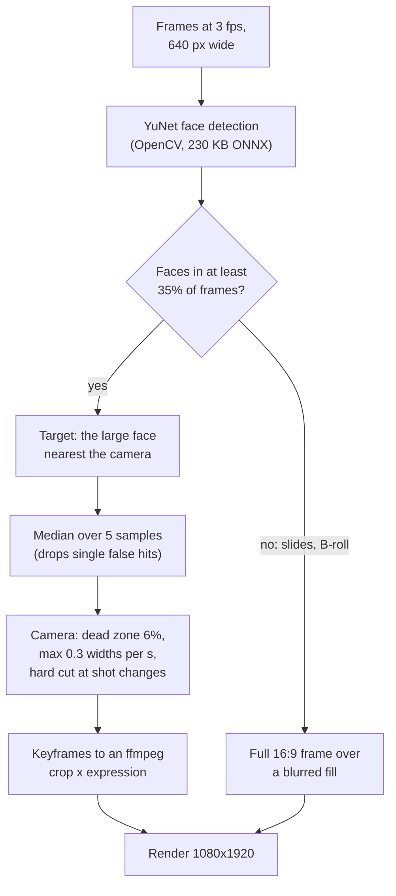
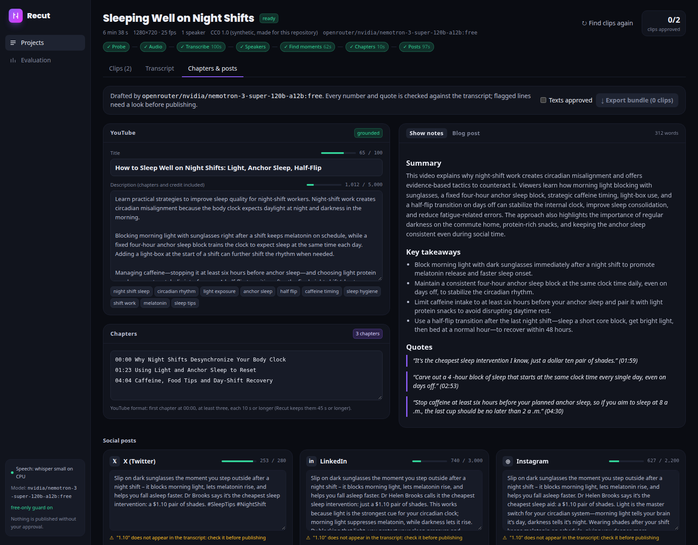
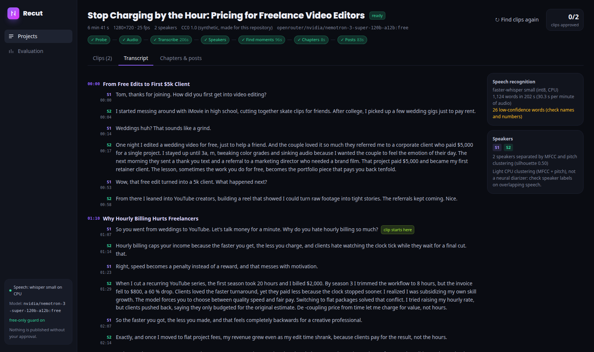
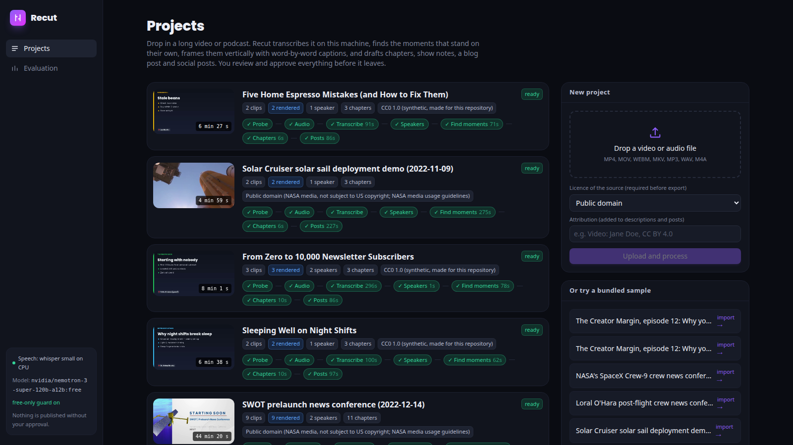
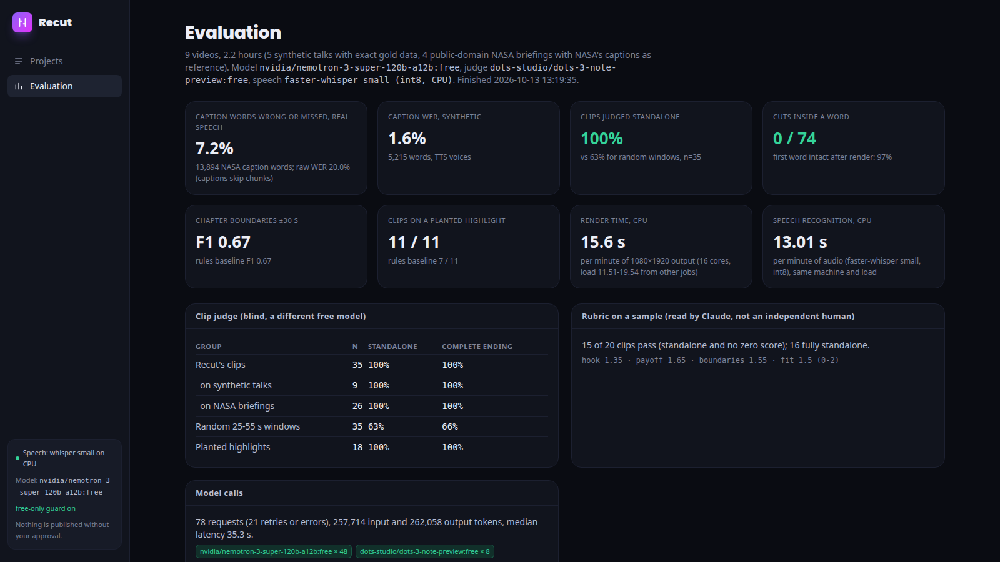

# Recut: turn a long video or podcast into vertical clips, captions, chapters and posts

**Recut finds the moments in a long video that work on their own and cuts them into 9:16 clips. It cuts in the silence between words, keeps the speaker's face in frame and burns in animated word-by-word captions. It also writes YouTube chapters, a description, show notes, a blog post and a post for each platform. Speech recognition, face tracking and rendering run on your own CPU, and the writing is done by free language models. Nothing gets downloaded or published until a person approves it.**

[](https://github.com/gelevanog/ai-video-repurposer/actions/workflows/ci.yml)


<!-- demo-video -->


<sub>A real run on NASA's public-domain Crew-9 news conference (27 min 32 s, three speakers). `nvidia/nemotron-3-super-120b-a12b:free` picked eight moments and explained each one. The selected clip is previewed in a phone frame: the virtual camera follows the astronaut's face and the bold caption style highlights the word being spoken. Nothing has been rendered for this preview. On the right are the model's reason and scores, a trim bar where the cuts snap to the silences between words, and the two cut checks, each a clean cut in a gap 31-34 dB below speech level.</sub>



<sub>Frames from rendered 9:16 clips, one per caption style (bold with the title card, boxed, karaoke, pop, minimal). The framing comes from face tracking, and the wide shot on the right stays wide because there are two people in it.</sub>

**Measured on 2026-10-13** on a 16-core CPU with no GPU. The machine was shared with other jobs (load average 11 to 19). The test set has 13 videos, 2 h 40 min in total: 9 synthetic podcasts and talks with exact gold data and 4 public-domain NASA briefings. The free language model ran on 9 of them (2 h 10 min) before the free tier's daily request limit stopped the run ([details](#how-the-run-went)).

| | Result |
|---|---|
| Cuts inside a word | **0 of 74** model-picked cut points (0 of 102 for the rule baseline). When each rendered clip is transcribed again, its first word is intact in **36 of 37** clips and its last word in **37 of 37** |
| Clips that stand on their own, rubric on a sample (scored by Claude, not by an independent human) | **16 of 20** fully standalone, **15 of 20** pass the whole rubric (hook, payoff, clean start and end, platform fit) |
| Clips that stand on their own, blind LLM judge (`dots-3-note-preview:free`) | **35 of 35** model clips vs **63%** of random 25-55 s windows. On the 3 videos where the rule baseline was also judged: **17 of 17** model clips vs **9 of 17** rule-picked clips |
| Clips that land on a planted highlight (synthetic talks) | **11 of 11** model clips vs **7 of 11** for the rule baseline. Recall is **11 of 23**, because it asks for 2-3 clips per 7-minute talk and every talk has 5 planted highlights |
| Chapter boundaries vs gold (synthetic talks) | **9 of 9** predicted boundaries within ±15 s (mean error **2.7 s**), recall **50%** because about 3 chapters were requested per 7-minute talk while the scripts have 5. TextTiling baseline: 7 of 9 within ±15 s, mean error 6.7 s |
| Caption accuracy (faster-whisper `small`, CPU) | synthetic voices: **1.6% WER** (9,706 words). Real NASA speech: **7.2%** of NASA's caption words wrong or missed (13,894 words). Raw WER is 20.0% because NASA's live captions skip whole passages |
| Speakers (light MFCC clustering, no model) | **98.6%** of words with the right speaker on 5 two-voice podcasts. The speaker count is right in **9 of 9** synthetic videos, and all 4 single-voice talks are kept as one speaker |
| Framing | the face stays inside the 9:16 window in **96.8%** of sampled frames with face tracking vs 88.9% for a centre crop (25 tracked clips). The 12 slide-video clips automatically use the full frame over a blurred fill |
| Posts | **42 of 42** social posts within platform limits with no cut needed. **12 flagged** by the grounding check: 6 repeat an invented "$1.10" and 6 repeat a misheard "$1,400". 2 of 9 videos got no social posts because the model ran out of tokens ([fixed](#findings-from-the-run-fixed), not re-run) |
| CPU time | speech recognition **13 s** per minute of audio under this load (**3.5-5.3 s** when the machine was quiet). Rendering **15.6 s** per minute of 1080×1920 output, so a 40 s clip takes about 10 s. The free model needed **21 s** per minute of source for clips, chapters and texts |
| Cost | **$0**: 127 requests to OpenRouter (78 for the evaluation run), every requested and served model `:free` ([ledger](results/calls.jsonl)) |

**The honest verdict:** the parts done in code behave the way they were designed to. No cut landed inside a word, and transcribing the rendered clips again backs this up. The one miss was a clip opening on the instrument name "KaRIn", which the second transcription heard differently; that cut sat 0.21 s before the word. Face tracking keeps the speaker in frame, every post fit its platform's limit, and the grounding check caught both real errors in the generated posts. The free model is good at picking moments: all 11 clips on the synthetic talks landed on a planted highlight, compared with 7 of 11 for the keyword rules, and its chapter boundaries were within 3 seconds on average. Two things are weaker than the table suggests. The LLM judge is lenient: it called 63% of random windows standalone and every model clip standalone. My own reading of a 20-clip sample is lower, 16 of 20 fully standalone, and the 4 that failed open with "that signal", "the gentler approach" or a garbled sentence. Also, the system only finds as many moments as it is asked for, so recall of the planted highlights is about half. The run also exposed mistakes upstream of the model. The test voice read "$10" as "a dollar ten", Whisper heard "$15 ... $400" as "$1.15 ... $1.400", and the model turned these into "$1.10" and "$1,400". The grounding check flagged every one of these posts. The free tier's daily limit stopped the model run after 9 of 13 videos, and the last four synthetic talks are evaluated only by the rule baseline. Details and every number's source are below.
## What problem it solves

Creators, podcasters, coaches and agencies sit on hours of long-form video: interviews, webinars, livestreams, talks. The audience is on TikTok, Reels and Shorts, so every episode should also become five to ten vertical clips with captions, a YouTube description with chapters, show notes, a blog post and a post per platform. Done by hand that is a day of editing per episode: scrubbing for the good moments, cutting so a clip does not start mid-word or end before the point, reframing a 16:9 shot to 9:16 around the speaker, timing captions word by word, and writing the same episode up six different ways within six different character limits.

Recut does that first pass on your own machine and hands you a review screen. It transcribes locally (only the transcript text goes to the language model), picks the moments that work on their own, explains each pick, cuts them where there is silence, frames the speaker, burns in animated captions, and drafts every text. You trim, fix a caption word, choose a style, approve, and download. Nothing is published, and nothing can be downloaded or exported, until a person has approved it.

## Features

- **Local speech recognition with word timestamps**: faster-whisper `small` (int8, CPU) with voice-activity filtering; numbers that Whisper splits ("$40" + ",000") are joined back.
- **Speakers**: light CPU diarization (MFCC and pitch statistics per speech chunk, agglomerative clustering, the number of speakers chosen by silhouette score) with no model download. When the voices are not separable it says "single speaker" instead of inventing speakers.
- **Moment finding with reasons**: the model reads numbered sentences and answers with sentence ranges, a title, the hook, why the clip works, and scores for hook, payoff, standalone, clarity and virality. It never gives timestamps, so a clip can only start and end on sentences that exist. Long videos are read in overlapping 14-minute windows and duplicates are merged.
- **Cuts that never fall inside a word**: code fits each pick to 20-60 s by whole sentences, then cuts in the quietest 30 ms of the gap before the first word and after the last, from the audio level, not only from Whisper's word times. Every cut is checked: inside a word, closer than 30 ms to a word, or on loud audio.
- **A standalone lint the model cannot talk its way past**: clips that open with "And", "He" or "That", say "as I said", open with a greeting, end on a question or end without a full stop are flagged and ranked lower, next to the model's own scores.
- **Vertical rendering in one ffmpeg pass**: frame-accurate cut; 9:16 framing by **face tracking** (OpenCV YuNet, a 230 KB model, 3 frames per second, a smoothed virtual camera with a dead zone, a speed cap and hard cuts at shot changes), a centre crop, or the full frame over a blurred fill when there is no face (slides, screen recordings), or an audiogram for audio-only podcasts; burned-in **word-level animated captions** in five styles (bold, boxed, karaoke, pop, minimal; bundled OFL fonts); an optional title card; fades; loudness normalized to -14 LUFS.
- **Chapters in YouTube's format**: the model marks topic changes by sentence number; code enforces YouTube's rules (first at 00:00, at least three, at least 10 s; Recut keeps them 45 s or longer). Offline, a TextTiling-style lexical-cohesion segmenter does it.
- **Publishing texts with limits and grounding**: SEO title (100 characters, warned above 70), description with chapters and the licence credit appended by code, tags within YouTube's 500-character total, show notes with quotes inserted verbatim from the transcript by code, a blog post, and posts for X, LinkedIn, Instagram, TikTok, Threads and Facebook. Every post is counted the way its platform counts (X: URLs as 23, emoji as 2); an over-limit post gets one rewrite request, then a cut at a word boundary that is flagged. **Every number and every quotation is checked against the transcript** and flagged when it was never said.
- **Review UI**: a timeline of the whole video (loudness, speaker turns, chapters, clips coloured by score); a clip editor with a **phone-frame live preview** that frames the source and draws the chosen caption style word by word before anything is rendered; draggable cut handles that snap to word gaps and sentence nudges; per-word caption fixes (low-confidence words are highlighted); style, framing and title card; approve, reject, render, download; the transcript with speakers; and a "chapters and posts" tab with counters, flags and per-post approval.
- **Safety and provenance**: downloads need an approved clip; exports need the source licence recorded and contain only approved clips and texts; approving a clip with an error-level finding (a mid-word cut, a length outside 20-60 s) needs an explicit force; the licence and attribution travel with the project into descriptions, posts and the export manifest; local paths can be imported only from configured folders; every review action is in an audit log; transcripts are treated as untrusted data in prompts and in the MCP server.
- **MCP server** for Claude Code and Claude Desktop (below): Claude can be the editor while Recut does the media work.
- **Providers**: `openrouter` with a **free-only guard** on by default (refuses any model id without `:free`, `:online` and plugins, and rejects an answer served by a non-free model), `compat` (any OpenAI-compatible endpoint, also guarded unless `RECUT_ALLOW_PAID_MODELS=true`), and `fake`, a rule-based implementation of every model task, so tests, CI and the demo run with no key. Real calls go through a disk cache, a shared rate limit, retries with backoff, a hard call budget and a call ledger ([`results/calls.jsonl`](results/calls.jsonl)) that records model ids, status, latency and tokens, never prompts.

## How it works

**The pipeline.** Code (green) decides every cut, frame and limit; the model (orange) only reads and proposes; you (blue) approve.

```mermaid
flowchart LR
    SRC(["Video or podcast<br/>upload or local file"]) --> P["Probe, SHA-256,<br/>16 kHz audio"]
    P --> ASR["faster-whisper small, CPU<br/>word timestamps"]
    ASR --> DIA["Speakers: MFCC + pitch<br/>clustering, or single"]
    DIA --> SEN["Sentences from<br/>timed words"]
    SEN --> LLM1["Model: pick moments<br/>by sentence number,<br/>with reasons and scores"]
    LLM1 --> SNAP["Fit to 20-60 s by sentences,<br/>cut in the quietest gap,<br/>check every cut"]
    SNAP --> LINT["Standalone lint and<br/>ranking score"]
    SEN --> LLM2["Model: chapters,<br/>metadata, blog, posts"]
    LLM2 --> RULES["YouTube rules, platform<br/>limits, verbatim quotes,<br/>number and quote grounding"]
    LINT --> UI["Review UI:<br/>trim, captions, style,<br/>approve"]
    RULES --> UI
    UI --> R["ffmpeg render: face-tracked<br/>9:16, animated captions,<br/>-14 LUFS"]
    R --> OUT(["Approved clips, SRT,<br/>chapters and texts (zip)"])

    classDef code fill:#e6f4ea,stroke:#2b8a3e,color:#1c2330
    classDef model fill:#fff4e0,stroke:#b35c00,color:#1c2330
    classDef human fill:#e8eefc,stroke:#3b5bdb,color:#1c2330
    class P,ASR,DIA,SEN,SNAP,LINT,RULES,R code
    class LLM1,LLM2 model
    class UI,SRC,OUT human
```



**One clip, from the model's pick to a clean cut** (illustrative values). The model answers with sentence numbers; code turns them into times and checks the result.



**Framing a speaker.** Faces are detected on 3 frames per second; a virtual camera follows the main face only when it leaves a dead zone, at a capped speed, and jumps at shot changes. The path becomes a piecewise-linear `crop` expression that ffmpeg evaluates per frame.


## Quick start (no API keys)

You need Python 3.12 with [uv](https://docs.astral.sh/uv/), Node.js 24 and ffmpeg (with libass, as in the Ubuntu, Debian and Homebrew packages).

```bash
git clone https://github.com/gelevanog/ai-video-repurposer && cd ai-video-repurposer
make install          # uv sync --extra asr --extra synth, npm ci
make serve            # API on :8000; imports the bundled demo episode and processes it with the offline model
make web              # review UI on http://localhost:3000
```

Or from the command line:

```bash
uv run recut process data/samples/creator-margin-ep12.mp4 --license "CC0 1.0" --render-top 2
uv run recut list
uv run recut render <project-id> --top 3
```

Or everything in Docker: `docker compose up --build` (UI on :3000, API on :8000). The first transcription downloads faster-whisper `small` (about 460 MB) into a cache volume.

Without faster-whisper installed, Recut reads a transcript saved next to the media (`<file>.words.json`, as for the bundled sample); `uv run recut transcribe video.mp4` writes one.

## Run with free models via OpenRouter

```bash
export OPENROUTER_API_KEY=...            # never committed: from the environment or .env
export RECUT_LLM_PROVIDER=openrouter     # default model nvidia/nemotron-3-super-120b-a12b:free, fallback nemotron-3-ultra
uv run recut process talk.mp4 --license "CC BY 4.0" --attribution "Talk by Jane Doe, CC BY 4.0"
```

The free-only guard refuses any model id that does not end in `:free` before a request is built. To use a paid or private model deliberately, set `RECUT_ALLOW_PAID_MODELS=true` with `RECUT_LLM_PROVIDER=compat`, `RECUT_LLM_BASE_URL`, `RECUT_LLM_API_KEY` and `RECUT_LLM_MODEL` (any OpenAI-compatible endpoint: OpenAI, a gateway, vLLM).

## Use with Claude Code and Claude Desktop

`recut mcp` runs an [MCP](https://modelcontextprotocol.io) server (Python SDK `mcp==2.3.0`, stdio or Streamable HTTP). With it, **Claude can be the editor**: Claude reads the transcript and decides which moments, chapters and posts to make; Recut does what a model should not be trusted with: speech recognition with word timestamps, cut points that never fall inside a word, the standalone lint, face-tracked 9:16 rendering with burned-in captions, YouTube's chapter rules, platform length limits and grounding checks. There is deliberately **no approve or publish tool**: approving a clip for download stays a person's click in the UI.

| Tool | What it does |
|---|---|
| `probe_media(path)` | Duration, resolution, frame rate, audio and video streams of a local file (only from allowed folders). |
| `transcribe(path, license, attribution)` | Local faster-whisper with word timestamps plus speakers; creates (or reuses) a Recut project and returns numbered sentences `[n] mm:ss.s-mm:ss.s S1: text`, marked as untrusted data. |
| `get_transcript(project_id, start, count)` | More sentences, paged. |
| `snap_clip(project_id, first_sentence, last_sentence)` or `(start, end)` | Read-only: exact cut points in the silences, the length fitted to 20-60 s by whole sentences, cut checks and the standalone lint. |
| `save_clip(project_id, start, end, title, caption_style, caption)` | Adds the clip to the project for review (status stays "suggested"). |
| `suggest_clips(project_id)` | Recut's own moment finder with the model configured for Recut (offline rules by default), for comparison. |
| `render_clip(project_id, clip_id, caption_style, layout, title_card)` | Renders 1080x1920 MP4 on this machine and returns the path and render time. |
| `make_chapters(project_id, chapters)` | Validates your chapters (sentence numbers + titles) against YouTube's rules and returns the description text; without `chapters`, Recut's model proposes them. |
| `check_post(text, platform, project_id)` | Length the way the platform counts it, a suggested cut, and every number and quote checked against the transcript. |
| `list_projects()` | Projects with status and clip counts. |

**Connect.** Clone, `uv sync --extra asr`, then in Claude Code (everything after `--` is the command that starts the server):

```bash
claude mcp add recut -e RECUT_ALLOWED_SOURCE_DIRS=/absolute/path/to/your/videos \
  -- uv run --directory /absolute/path/to/ai-video-repurposer recut mcp
```

`--scope project` writes the entry to `.mcp.json` instead; this repository ships it as [`.mcp.json.example`](.mcp.json.example) so a clone does not load it automatically. Run `/mcp` in a session to check that `recut` is connected. For Claude Desktop, add the same entry to `claude_desktop_config.json` (`~/Library/Application Support/Claude/` on macOS, `%APPDATA%\Claude\` on Windows) with the absolute path of `uv` (from `which uv`), then restart Desktop:

```json
{
  "mcpServers": {
    "recut": {
      "command": "/absolute/path/to/uv",
      "args": ["run", "--directory", "/absolute/path/to/ai-video-repurposer", "recut", "mcp"],
      "env": { "RECUT_ALLOWED_SOURCE_DIRS": "/absolute/path/to/your/videos" }
    }
  }
}
```

Streamable HTTP: `uv run recut mcp --http --port 8765` serves `http://127.0.0.1:8765/mcp` (connect with `claude mcp add --transport http recut http://127.0.0.1:8765/mcp`). Projects created through MCP appear in the review UI, because both read `RECUT_DATA_DIR`.

**Example prompts.**

1. *"Transcribe ~/videos/episode-41.mp4 (my own content), find the three best 30-45 second moments for Shorts and render them in the pop style."* Claude calls `transcribe`, reads the numbered sentences and runs `snap_clip` on each candidate. If the lint flags one ("starts with 'And': may continue a thought from before the clip"), Claude moves it or drops it. Then it calls `save_clip` and `render_clip` and lists the MP4 paths with their render times. You approve the clips in the UI.
2. *"Write YouTube chapters for that episode."* Claude proposes sentence numbers and titles. `make_chapters` moves the first one to 00:00, drops any that start less than 45 s after the previous one, and returns text ready for the description.
3. *"Draft an X post and a LinkedIn post about it."* Claude writes them and checks each with `check_post`, which reports the length as X counts it (a link counts as 23 characters) and flags any number or quotation that is not in the transcript.

**Limits.** Paths must be inside `RECUT_ALLOWED_SOURCE_DIRS` (plus the bundled samples and test set). Transcription and rendering run synchronously in the tool call (minutes for a long video; Claude Code waits). Output is capped at about 24,000 characters per call (`RECUT_MCP_MAX_OUTPUT_CHARS`); long transcripts are paged.
## Evaluation

### The test set

| Part | Videos | Duration | Reference data |
|---|---|---|---|
| Synthetic podcasts and talks (CC0, made for this repository) | 9 | 60 min | exact transcript, time and speaker of every sentence, chapter starts, one planted highlight per chapter |
| NASA briefings (public domain, [images.nasa.gov](https://images.nasa.gov)) | 4 | 100 min | NASA's own caption files (reference transcript); real rooms, real faces, 1-3 speakers |

The synthetic items are podcasts and talks on freelance pricing, shift-work sleep, newsletter growth, espresso, remote-team rituals, emergency funds, marathon training and giving feedback, plus the bundled demo episode. They were voiced with Kokoro-82M on CPU (two voices for the podcasts) over generated slides. I wrote outlines with one highlight idea per chapter. A free model (`nemotron-3-ultra-550b-a55b:free`, the fallback after `gemma-4-31b-it:free` was rate-limited) expanded the outlines into scripts, and code validated each script: exactly one 90-140-word "highlight" turn per chapter, written to stand alone, while the other turns refer back to earlier ones. Because the audio is generated, the gold data is exact. That is what makes it possible to score chapter boundaries, speaker labels and "did it find the planted moment" without a human labeller. The scripts were drafted by the same model family that picks the clips (NVIDIA Nemotron), which may make the planted highlights easier for it to recognize.

The NASA items are a crew news conference (27 min), a post-flight news conference (23 min), a satellite prelaunch briefing (44 min) and a 5-minute demo video. Their captions are the WER reference, but they were made by a live captioner. They skip whole passages: the post-flight conference has about a fifth fewer caption words than words spoken, and its caption file starts with 5 min 32 s of music that is not in the video, which the scorer aligns automatically. So for real speech the README reports the share of caption words that are wrong or missing in the transcript, alongside the raw WER.

Media is not committed. [`data/testset/manifest.json`](data/testset/manifest.json) lists every item with its licence, credit, source page and SHA-256. `make testset` downloads the NASA files (about 1.1 GB, checked against the checksums) and renders the synthetic ones. The demo episode and its transcript are committed in [`data/samples/`](data/samples) (1.7 MB), so CI and the zero-key demo need no download.

### How the run went

Everything is in [`results/`](results): one JSON per video per run ([`results/main/items/`](results/main/items) for the free model, [`results/rules/items/`](results/rules/items) for the rule baseline), [`summary.json`](results/summary.json), the CPU benchmark ([`bench.json`](results/bench.json)), the model smoke test ([`smoke.json`](results/smoke.json)), the rubric ([`rubric.json`](results/rubric.json), sample in [`results/main/rubric_sample.md`](results/main/rubric_sample.md)) and the [call ledger](results/calls.jsonl).

| Role | Model |
|---|---|
| Clips, chapters, metadata, blog, social posts | `nvidia/nemotron-3-super-120b-a12b:free` (reasoning effort low), fallback `nvidia/nemotron-3-ultra-550b-a55b:free` |
| Clip judge | `google/gemma-4-31b-it:free` requested; every verdict was served by the fallback `dots-studio/dots-3-note-preview:free` (gemma was rate-limited upstream all day) |
| Test-script drafting | `nvidia/nemotron-3-ultra-550b-a55b:free` (as the fallback of `gemma-4-31b-it:free`) |

**Choosing the model** ([`smoke.json`](results/smoke.json)): six free models got the same clip-picking task on the demo episode. `nemotron-3-super` (43 s), `nemotron-3-ultra` (38 s) and `dots-3-note-preview` (44 s) all returned valid picks. `gemma-4-31b-it` was rate-limited upstream, `inkling` refuses non-agent clients, and `nemotron-3.5-lightning` spent its whole token budget thinking.

**The daily limit.** The run stopped at 07:10 UTC, when OpenRouter answered `free-models-per-day` (the free tier's daily request cap, shared by every project on the account). At that point 9 of the 13 videos had been processed by the model. The four remaining synthetic talks are in the rule baseline (speech, speakers, chapters, cuts) but not in the model run. `make eval-resume` finishes them after the limit resets, using the disk cache for everything already answered.

### 1. Clips

| | Free model (9 videos) | Rule baseline (same 9) |
|---|---|---|
| Clips | 37 (median 32.7 s, all 20-60 s) | 40 (median 38.6 s) |
| Cut points inside a word (Whisper word times) | **0 of 74** | 0 of 80 |
| Cut points within 30 ms of a word / on audio louder than -12 dB vs speech | 2 / 6 | 0 / 13 |
| Median audio level at the cut, relative to speech | -32 dB | -27 dB |
| Rendered clips re-transcribed: first word / last word intact | **36 / 37**, **37 / 37** | (not rendered) |
| Clips that land on a planted highlight (synthetic) | **11 of 11** | 7 of 11 |
| Lint warnings (dangling reference, starts with a connector, tight or loud cut) | 27% of clips | 30% of clips |

**Are the clips standalone?** Two independent checks were run, and they disagree on how often.

- **The blind LLM judge** read only each clip's words, shuffled together with random 25-55 s windows and the planted highlights. It called **35 of 35** model clips standalone, **18 of 18** planted highlights, and also **63%** of random windows. It separates good clips from random ones, but it is lenient. On the 3 videos where the baseline's clips were judged too (the daily limit cut that off), it called **17 of 17** model clips and **9 of 17** rule-picked clips standalone. Two batches of the same random windows also got different verdicts (53% and 35% standalone), so the judge is noisy too.
- **A rubric on a seeded sample of 20 clips** (10 synthetic, 10 NASA), scored 0-2 for standalone, hook, payoff, clean boundaries and platform fit, gave **16 of 20 fully standalone** and **15 of 20 passing** (standalone and no zero). Mean hook was 1.35 and mean payoff 1.65. The NASA clips are standalone (9 of 10) but weaker as social content (hook 1.1). The four that were not standalone open with "that signal", "the gentler approach", "The Welcome series" or a garbled sentence. **I (Claude, the AI assistant that built Recut) scored this rubric** by reading the transcripts; it is not an independent human rating ([`rubric.json`](results/rubric.json)).

### 2. Chapters (synthetic talks, gold boundaries)

| | Free model | TextTiling baseline |
|---|---|---|
| Predicted / gold boundaries | 9 / 18 | 9 / 18 |
| Within ±15 s (precision) | **9 of 9**, mean error **2.7 s** | 7 of 9, mean error 6.7 s |
| Within ±30 s | 9 of 9 | 9 of 9 |
| Recall | 50% | 50% (39% at ±15 s) |

Both were asked for about one chapter every two minutes, which comes to 3 for a 7-minute talk, while the scripts have 5 sections of about 80 s. Recall is low for that reason. Precision is the more useful number: every chapter start the model proposed was a real topic change, within 3 seconds on average. 8 of the 9 videos produced YouTube-valid chapter lists. The 2-minute demo episode is too short for three chapters of 45 s.

### 3. Speech and speakers

| | Words | WER | Reference words wrong or missed |
|---|---|---|---|
| Synthetic voices (9 videos) | 9,706 | **1.6%** | 1.2% |
| NASA briefings (4 videos, NASA captions) | 13,894 | 20.0% (the captions skip passages) | **7.2%** |

Speakers on 5 two-voice podcasts: **98.6%** of words got the right speaker after the best label mapping, and the speaker count was right in 9 of 9 synthetic videos. On the NASA videos, with 2-3 people at a table, the clustering found 2-3 speakers, but there is no gold to score them against. Two clearly different synthetic voices are the easy case for MFCC clustering. Expect worse on similar voices and overlapping speech.

### 4. Rendering and framing

25 clips from the NASA videos used face tracking. The main face was inside the 9:16 window in **96.8%** of sampled frames, compared with 88.9% for a fixed centre crop. People at a press-conference table mostly sit near the middle, so a centre crop is already fairly good there. 12 clips from slide videos and the solar-sail B-roll fell back automatically to the full frame over a blurred fill. CPU time on the 16-core machine, while other jobs kept the load average at 11-19 ([`bench.json`](results/bench.json)): speech recognition 13 s per minute of audio (the same model took 3.5-5.3 s per minute earlier in the day, on a quieter machine), speaker clustering 0.1 s per minute, rendering **15.6 s per minute of 1080×1920 output** including face detection.

### 5. Posts and grounding

The 7 videos with social posts got 42 posts, **all within their platforms' limits**, with no rewrite request and no cut needed. 2 videos got none: the free reasoning model used its whole token budget thinking about six posts at once. After the run, Recut was changed to retry in two smaller requests (and to tell the model that code measures the lengths), but the run was not repeated because of the daily limit.

The grounding check flagged **12 social posts and 4 long-form passages**, and each flag pointed at something real:

- **"$1.10 pair of shades"** in all six posts of the sleep talk. The script says "$10". The test voice read it as "a dollar ten", Whisper wrote "a dollar ten", and the model turned that into "$1.10".
- **"$1,400 grinder"** in the espresso talk. The script says "$15 kitchen scale ... $400 grinder", Whisper heard "$1.15 ... $1.400", and the model "corrected" it to $1,400.
- **3 quotes with ellipses** in the NASA post-flight show notes, stitched together from separate sentences, so they are not verbatim.

The first findings of the run, false alarms on numbers in the video title and in the licence credit (for example "1.0" from "CC0 1.0") and on "three and a half" written as "3.5", were fixed before these counts. The counts come from re-running the checks on the stored texts, with no new model calls.

### Findings from the run, fixed

- **Whisper splits numbers** into two "words" ("$40" + ",000"), which looked like "$40 ,000" in captions. They are now joined.
- **Six posts in one request** sometimes used the reasoning model's whole output budget. The request now falls back to two smaller ones, and the output ceiling is 16,000 tokens.
- **Grounding false positives** from the video title, the appended credit and "three and a half" (above).
- **NASA caption files that do not match the video's cut** (a 5.5-minute music intro, a different end). The scorer now aligns caption timing to the transcript's word density before computing WER.
- **The script validator** rejected a draft with a 169-word chapter; the floor was lowered from 170 to 150 words.
- **The clip judge** returned no verdicts for one video (the batch failed). It is recorded as unanswered and can be retried with `recut eval rejudge`.

### Screenshots

| | |
|---|---|
|  |  |
| **Chapters and posts.** The sleep talk: YouTube title and description with counters, chapters, show notes, and social posts with platform counters. Every post carries the "$1.10" grounding flag described above. | **Transcript.** Speaker turns with timestamps, chapters inline and the clip starts marked; the side panel shows the recognition speed and the diarization note. |
|  |  |
| **Projects.** Every processed video with its stages and the upload panel. The licence is required before export. | **Evaluation.** The numbers above, read from `results/summary.json`. |
## Key design decisions

**Why the model answers with sentence numbers, not timestamps.** A language model reading a transcript is good at the editorial question (is this a moment, does it stand on its own, what is the hook) and bad at arithmetic on timestamps. If it returns times, it returns times that cut words in half. So it gets numbered sentences and answers with a range of them; the cut itself is code: whole sentences, 20-60 s, in the quietest 30 ms of the silence on each side, checked against the word times and the audio level. That is why the evaluation finds 0 cuts inside a word out of 74.

**Why a lint next to the model's scores.** Asked whether its own pick "stands alone", a model says yes with a high score almost every time. The lint is cheap and boring: it flags a clip that opens with "And", "He" or "That", says "as I said", opens with a greeting or ends on a question, and those findings lower the ranking and are shown to the reviewer. The blind judge in the evaluation is a second opinion from a different model family.

**Why a live preview before rendering.** Rendering a minute of 1080x1920 takes about 16 s on CPU. The editor frames the source, draws the caption style and highlights the spoken word in the browser, from the same framing plan and word times the renderer uses, so trimming and fixing captions is instant and the render happens once, at the end.

**Why face tracking with a slow camera.** Following a face box frame by frame looks like a security camera. The virtual camera only moves when the face leaves a dead zone, at a capped speed, and cuts (instead of panning) at a shot change. When there is no face in most frames (slides, screen recordings, B-roll), cropping a 16:9 frame to its middle third loses the content, so the auto layout shows the full frame over a blurred fill instead.

**Why grounding checks and verbatim quotes.** A post that says "a 300% jump" when the guest said "doubled" is the kind of mistake that ends a client relationship. Quotes in the show notes are inserted from the transcript by code (the model only picks the sentence numbers), and every number and quotation in every generated text is checked against the transcript and flagged for the reviewer.

**Why approval in the API, not only in the UI.** "Human in the loop" is only true if the export path enforces it: the download endpoint refuses an unapproved clip, the export refuses without a recorded licence, and the MCP server has no approve tool at all.

## Configuration

All settings are environment variables (or `.env`); [`.env.example`](.env.example) documents them. The ones you are most likely to change:

| Variable | Default | What it does |
|---|---|---|
| `RECUT_LLM_PROVIDER` / `RECUT_LLM_MODEL` | `fake` / provider default | `fake` (offline rules), `openrouter`, `compat` |
| `RECUT_LLM_FALLBACK_MODELS` | `nvidia/nemotron-3-ultra-550b-a55b:free` | OpenRouter fallbacks (all `:free`) |
| `RECUT_REQUIRE_FREE_MODELS` / `RECUT_ALLOW_PAID_MODELS` | `true` / `false` | the free-only guard, and the explicit opt-in that lifts it |
| `RECUT_LLM_BASE_URL` / `RECUT_LLM_API_KEY` | none | the `compat` endpoint (any OpenAI-compatible server) |
| `OPENROUTER_API_KEY` | none | key for the `openrouter` provider |
| `RECUT_LLM_CACHE` / `RECUT_LLM_LEDGER` / `RECUT_LLM_MAX_CALLS` | `true` / `results/calls.jsonl` / `1500` | disk cache, call ledger, hard cap on real calls |
| `RECUT_LLM_MIN_SECONDS_BETWEEN_REQUESTS` | `3.2` | shared rate limit (free OpenRouter models allow about 20 requests a minute) |
| `RECUT_ASR` / `RECUT_WHISPER_MODEL` / `RECUT_WHISPER_COMPUTE_TYPE` | `whisper` / `small` / `int8` | speech recognition; `sidecar` reads `<file>.words.json` |
| `RECUT_DIARIZE` / `RECUT_MAX_SPEAKERS` | `true` / `4` | speaker separation |
| `RECUT_CLIP_MIN_SECONDS` / `RECUT_CLIP_MAX_SECONDS` | `20` / `60` | clip length limits |
| `RECUT_CLIPS_PER_10_MINUTES` / `RECUT_MAX_CLIPS` | `3` / `12` | how many clips to suggest |
| `RECUT_WINDOW_MINUTES` | `14` | long transcripts are read in windows of this length |
| `RECUT_RENDER_WIDTH` / `RECUT_RENDER_HEIGHT` / `RECUT_RENDER_PRESET` / `RECUT_RENDER_CRF` | `1080` / `1920` / `veryfast` / `21` | output video |
| `RECUT_LOUDNORM` | `true` | normalize to -14 LUFS |
| `RECUT_DATA_DIR` | `data/projects` | projects (project.json, audio, renders) |
| `RECUT_ALLOWED_SOURCE_DIRS` | none | local folders the API and the MCP server may import from |
| `RECUT_TRANSCRIPT_CACHE_DIR` | `.cache/transcripts` | transcripts keyed by file hash, so re-processing does not transcribe again |

## Project structure

```
src/recut/
  asr/            faster-whisper on CPU (word timestamps, split-number repair), sidecar transcripts, MFCC diarization
  clips/          moment finding (prompt, windows, validation, ranking), cut snapping, the standalone lint
  render/         face tracking and the virtual camera, ASS caption styles, the ffmpeg render
  content/        posts, show notes, blog, metadata; platform limits and X counting; grounding checks
  media/          ffmpeg/ffprobe wrappers (argument lists, never a shell), audio levels
  llm/            OpenRouter and OpenAI-compatible providers, free-only guard, budget wrapper (cache, ledger, retries)
  eval/           test set (manifest, NASA download, synthetic talks: scripts, Kokoro voices, slides), runner, judge,
                  report, CPU benchmark, smoke test
  api/            FastAPI app and the in-process job runner
  chapters.py     chapters and YouTube rules, TextTiling baseline;   text.py  sentences, WER normalization
  pipeline.py     the stages and every review action;   store.py  atomic project storage;   models.py  the data model
  fake_tasks.py   the offline rule-based model;   mcp_server.py  the MCP server;   cli.py  recut ...
assets/           fonts (OFL) and the YuNet face model (MIT)
data/samples/     the demo episode (CC0) and its transcript
data/testset/     manifest with licences and checksums, synthetic scripts and outlines
web/src/          Next.js review UI (timeline, clip editor with the phone preview, transcript, chapters and posts)
results/          evaluation results, benchmark, smoke test, rubric, call ledger and summary
tests/            pytest (no keys, no network)
```

## Testing

```bash
make test        # pytest: no keys, no network (ffmpeg needed for the media tests)
make test-fast   # without the real renders
make lint        # ruff check, ruff format --check, mypy --strict
make web-lint    # eslint + tsc --noEmit (strict)
make web-build   # next build
make eval-rules  # the whole evaluation with the offline rules (no API calls)
```

177 tests:

| Suite | What it covers |
|---|---|
| `test_text.py` | sentence splitting (abbreviations, speaker changes, run-ons), timestamps, WER normalization (numbers, contractions, currency), split-number repair |
| `test_snap.py` | cut points in the gaps and never inside a word, quietest point, fitting to 20-60 s by sentences, word and sentence snapping, the end of the media |
| `test_lint.py` | connectors, dangling pronouns, context phrases, greetings, questions, length, cut findings, fillers |
| `test_suggest.py` | prompt format round trip, reply validation, ranking, hook grounding, windows, dedupe, the offline model, model failures |
| `test_chapters.py` | YouTube rules, merging, titles, TextTiling, model fallback and fill-up |
| `test_content.py` | X counting, truncation, tags, grounding of numbers (incl. "$40k"), quotes, descriptions with chapters and credit, the over-limit retry, failures |
| `test_diarize.py` | chunking, features, two synthetic voices separated, one voice kept single |
| `test_captions.py`, `test_crop.py` | every caption style, highlight, karaoke timing, escaping; the virtual camera (dead zone, speed cap, scene cuts, clamping, false detections), layouts, the ffmpeg expression evaluated against the plan |
| `test_render.py` | real ffmpeg renders of generated media: tracked crop, centre crop, audiogram, probe and audio extraction |
| `test_llm.py` | free-only guard on ids, bodies and served models, the paid opt-in, request shapes, error mapping, retries, cache, ledger without prompts, the hard cap |
| `test_pipeline.py`, `test_store.py` | the whole pipeline on the sample, resume after a failed stage, trims, caption fixes, approval guard, manual clips, render and export, licence guard, atomic storage with a backup after a zero-filled file |
| `test_api.py`, `test_mcp.py`, `test_cli.py` | every endpoint (range requests, the download guard, uploads), every MCP tool through the in-memory client and a real stdio subprocess, the CLI |
| `test_eval.py` | chapter scoring, highlight recall, speaker accuracy, random windows, the judge, SRT parsing, the manifest, script validation, the summary |

CI ([`.github/workflows/ci.yml`](.github/workflows/ci.yml)) installs ffmpeg and runs ruff, mypy, the tests, an offline CLI run that processes the sample and renders one clip, the UI's lint, type check and build, and both Docker builds, with no keys and no model downloads.

## Roadmap

- A neural diarizer as an option (pyannote or NeMo on a GPU) for overlapping speech and similar voices.
- Active-speaker framing: pick the face that is talking (lip motion or audio-visual sync) instead of the largest one.
- B-roll and zoom-in emphasis on key words, emoji captions, brand kits (fonts, colours, logo) per client.
- Direct publishing to YouTube, TikTok and Instagram behind the same approval step, with scheduling.
- GPU rendering (NVENC) and faster-whisper on GPU for agencies processing many hours a day.

## License

[MIT](LICENSE) © 2026 Ivan Savchenko. Bundled fonts: SIL Open Font License ([`assets/fonts`](assets/fonts)). YuNet face model: MIT ([`assets/models`](assets/models)). NASA media is not covered by NASA copyright; credit "NASA" (see each item in the manifest).
